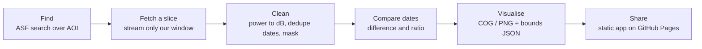

# Team Venus — Seeing the Dead Sea through the clouds

> Venus, the planet of light and love, turns against the current of the other planets, and burns
> brightest in the dark night sky. Named for a goddess, it is the light we steer by.

Venus is wrapped in permanent cloud; we know its surface only because radar sees through it. This
project reads Earth the same way — with **NISAR**, the joint NASA–ISRO radar mission — and points it at
a lake on our doorstep that is quietly disappearing.

**NASA Space Apps Challenge 2026 · "Dancing with the SARs" · Earth Science**

---

## What it does

We use NISAR L-band radar to watch the **Jordanian shore of the Dead Sea** between June and October
2026. Radar does not see colour; it measures how rough and how wet the ground is, which is exactly what
you need at a shoreline: open water answers almost not at all, so it goes black, while exposed,
salt-crusted mud answers loudly, so it goes bright. We turn twelve-day repeat passes into a small,
static, offline-capable web app: a map, a before/after swipe, a time slider across the acquisitions, and
a difference layer in decibels with a plain-language explainer. Everything the app shows is
pre-computed — the live demo needs no network, no backend and no API key.


## Why it matters

The Dead Sea is a closed basin: water leaves only by evaporation, and inflow has fallen. As the level
drops, the shore retreats, salt is exposed, and the ground becomes unstable — sinkholes have opened in
farmland along the Jordanian shore. A 12-day, all-weather record of where the water actually is turns a
slow emergency into something measurable: water accounting for a closed basin, coastal and agricultural
planning, and a template for wetlands elsewhere (for example Azraq, also in Jordan).

## Data

| Item | Value |
|---|---|
| Mission | NISAR (NASA / ISRO), L-band SAR |
| Product | **L2 GCOV** — Geocoded Polarimetric Covariance, terrain-corrected gamma-0 **power**, 20 m, UTM |
| Maturity | **PROVISIONAL** (CRID P05023) for the series; **VALIDATED** (P05036) only as a labelled latest state |
| Geometry | Descending track **151**, frame **073** (one geometry only — never mixed) |
| Dates | 2026-06-24 → 2026-10-10, 9 acquisitions at ~12-day cadence |
| Access | ASF DAAC via NASA Earthdata Login (free) |

Exact product names, verified layer paths, file sizes and the documented mission data gap are in
[`docs/DATA_SOURCES.md`](docs/DATA_SOURCES.md). Products are ~1.9 GB each, so the pipeline streams only
the small window over our AOI.

## First results (Gate 1, 2026-11-13)

Two dates from the same geometry — **2026-06-24** and **2026-10-10**, descending 151/073, PROVISIONAL —
streamed at 20 m over a 1231 × 505 pixel window (~10 × 24 km) and turned into dB imagery:

| | measured |
|---|---|
| open water, HV | ≈ −20.5 dB (clean, ~4 dB below land) |
| open water, HH | ≈ −13.7 dB (only ~6 dB below land — HH is not the water channel here) |
| mapped lake area | **140 ± 15 km²** of the 249 km² window (threshold sensitivity band) |
| change 06-24 → 10-10 | **smaller than the method's uncertainty** (≤ 2 km² net; thresholds move it by ±15 km²) |
| scene-wide offset | ≈ −0.8 dB in HV, ≈ +0.4 dB in HH — removed before interpreting |

We report the trend as **not yet detectable** rather than inventing one. See
[`docs/SCIENCE_NOTES.md`](docs/SCIENCE_NOTES.md) for what these numbers mean and
[`docs/DECISIONS.md`](docs/DECISIONS.md) for why the thresholds are derived per image.




Two stages, deliberately:

1. **Offline pipeline (Python).** Search, subset/stream, clean, compute change products, export small
   web-ready assets to `web/assets/`.
2. **Static web app (HTML/CSS/JS).** Loads only those assets. Deployable to GitHub Pages, and it also
   works offline from a local folder.

## How to run

### 1. Get the code and an environment

```powershell
git clone https://github.com/leenelzoubii/venus---dancing-with-the-sars.git
cd venus---dancing-with-the-sars

py -3.12 -m venv .venv
.\.venv\Scripts\python -m pip install --upgrade pip
.\.venv\Scripts\python -m pip install -r requirements.txt

# verify every dependency imports
.\.venv\Scripts\python scripts\00_check_environment.py
```

macOS / Linux:

```bash
python3.12 -m venv .venv
source .venv/bin/activate
python -m pip install --upgrade pip
python -m pip install -r requirements.txt
python scripts/00_check_environment.py
```

If you need byte-identical rebuilds, install the frozen set instead:
`python -m pip install -r requirements.lock.txt`.

### 2. Authenticate with NASA Earthdata

Create a free account at <https://urs.earthdata.nasa.gov/>, then either

- let `earthaccess` prompt you interactively:

  ```powershell
  .\.venv\Scripts\python -c "import earthaccess; earthaccess.login()"
  ```

- or write a `.netrc` (Windows: `C:\Users\<you>\.netrc`) so streaming and GDAL can authenticate without
  prompting:

  ```
  machine urs.earthdata.nasa.gov
      login YOUR_USERNAME
      password YOUR_PASSWORD
  ```

**Never commit credentials.** `.netrc`, `_netrc`, tokens and `.env` files are git-ignored, and no script
prints them.

### 3. Run the pipeline

```powershell
# 1. search: what does NISAR have over our AOI?
.\.venv\Scripts\python scripts\01_search_nisar.py --aoi dead_sea_east

# 2. inspect one product's real internal structure (streams metadata, no big download)
.\.venv\Scripts\python scripts\02_inspect_product.py

# 3. subset just the AOI window for the dates we need
.\.venv\Scripts\python scripts\03_fetch_subset.py --aoi dead_sea_east

# 4. change products (dB, difference, water masks)
.\.venv\Scripts\python scripts\04_make_change_products.py

# 5. the Hour 1-2 analysis (QC, contact sheets, offsets, water methods, patches)
.\.venv\Scripts\python scripts\06_qc_table.py --aoi dead_sea_east
.\.venv\Scripts\python scripts\07_contact_sheets.py --aoi dead_sea_east
.\.venv\Scripts\python scripts\08_offsets.py --aoi dead_sea_east
.\.venv\Scripts\python scripts\09_water.py --aoi dead_sea_east
.\.venv\Scripts\python scripts\04b_find_patches.py --aoi dead_sea_east

# 6. export the static web assets (PNG layers + manifest/stats/patches as .json and .js)
.\.venv\Scripts\python scripts\05_export_web_assets.py --aoi dead_sea_east --patch-log docs\patch_log.csv

# 7. validate the web assets before deploying (exit code 1 on any failure)
.\.venv\Scripts\python scripts\06_validate_web_assets.py

# 8. tests
.\.venv\Scripts\python -m pytest -q
```

The exported files in `web/data/` are built to be loaded by plain `<script>` tags, so they work from
file:// and on GitHub Pages without a server. Wiring the web app to them is the next step (Hour 3).

Any script that touches data accepts `--aoi <name>` (a key in `config/study_area.yaml`) or
`--aoi-wkt "POLYGON((...))"` for a one-off area, so trying a new location never requires code changes.

## Study area

`dead_sea_east` — the Jordanian east shore between Suweimeh and Ghor Haditha, just north of the Lisan
peninsula:

```
POLYGON((35.500 31.340, 35.600 31.340, 35.600 31.560, 35.500 31.560, 35.500 31.340))
```

≈ 11 × 24 km, about 550 × 1200 pixels at 20 m. Additional Jordanian AOIs can be added to the config as a
one-line edit (see the commented candidates: south evaporation ponds, Azraq wetland).

## Limitations, stated plainly

- **Nine acquisitions is a series, not a climatology.** We describe what changed in this window only.
- **One geometry.** All comparisons are descending track 151 / frame 073. Ascending products exist but
  are not mixed in, because geometry differences look like ground change.
- **A known mission gap.** NISAR has a permanent data gap `2026-07-27T22:03Z → 2026-08-10T00:55Z`, so
  the series jumps from 07-18 to 08-11. That is the spacecraft, not our code.
- **PROVISIONAL calibration.** Fully calibrated, partially validated. Reprocessing is expected in 2027;
  every layer records its product name and CRID.
- **20 m pixels vs a slow process.** A ~0.3 m lake-level drop over 3.5 months moves a shoreline by metres
  to tens of metres — a few pixels on gentle mudflats, essentially invisible against steep cliffs.
  Sub-pixel sinkholes cannot be resolved individually.
- **Water is not simply "dark".** Wind roughens the lake and brightens it; wet salt crust and wet mud can
  be bright too. Water masks are thresholded, sanity-checked, and reported with that uncertainty.
- **Interpretations are labelled.** What the data shows and what we hypothesise are kept separate,
  in the app and in [`docs/SCIENCE_NOTES.md`](docs/SCIENCE_NOTES.md).

## Future work

- Extend to the south evaporation ponds and Azraq wetland as additional AOIs with a location switcher.
- Add ascending-track cross-validation (172/017) as an independent check on the same events.
- Explore GUNW interferometric products for line-of-sight deformation and sinkhole precursors — only if
  pair quality and coherence hold up.
- Quantify water area per date with uncertainty, and compare against lake-level records.
- Bilingual English/Arabic interface with right-to-left layout.
- Then: an operational, 12-day, all-weather shoreline monitor for closed basins — the kind of product
  NISAR was designed to make routine.

## Team

**Team Venus** — two women, data science graduates, one based in Amman, Jordan. Named for the planet
that turns against the current and burns brightest in the dark.

## Licence and acknowledgements

Released under the [MIT Licence](LICENSE). NISAR data are a joint NASA–ISRO product, processed and
archived by the Alaska Satellite Facility DAAC and distributed through NASA's Earthdata Cloud; data are
freely available under NASA's open data policy. Basemaps and ancillary layers remain under their
providers' terms. NASA does not endorse any non-U.S. Government entity or any product of this project.
